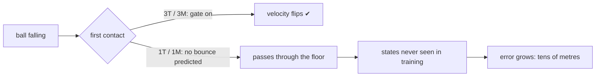
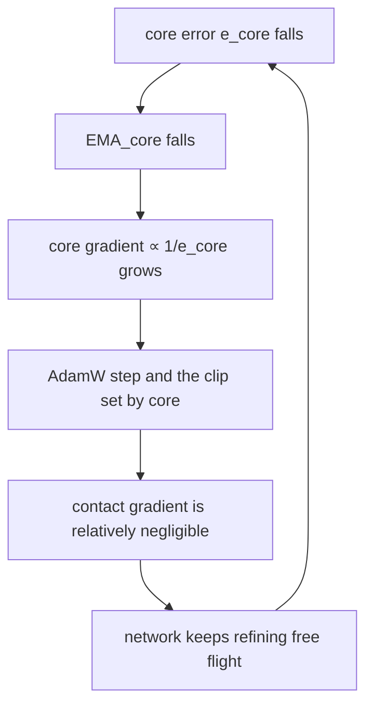
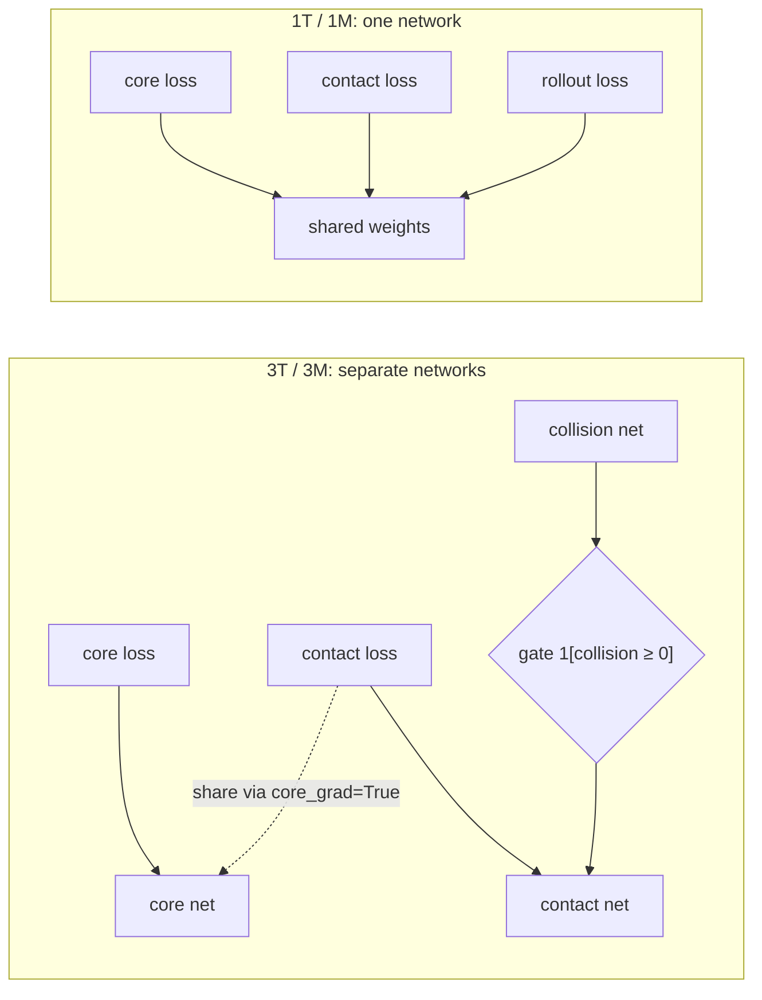

# Why the single network never learns the bounce

> Bouncing ball (`ContactNRD-Ball`), seed 61. Covers the 1T (Go2 network), the 1T (3T core
> network) and the 1M; the 3T / 3M are the reference.
>
> Status: the observations come from the training logs; the mechanism is derived from the
> code and **has not yet been tested by a dedicated run**.

---

## 1. What we see

| model | params | best score | 1.7 s position error (median) | contact loss |
|---|---|---|---|---|
| 3T (released) | ~0.8M × 3 | 0.0025 | ~1 mm | falls |
| 3M | 2.11M | 0.0031 | 1.07 mm | 18 |
| 1T (Go2 network) | 4.8M | 36.98 | 25 m | **≈ 2.7e6, flat** |
| 1T (3T core network) | 0.8M | 45.75 | 33.6 m | **≈ 2.7e6, flat** |
| 1M | 0.65M | 38.72 | 27.9 m | **≈ 2.7e6, flat** |

A contact loss of about $2.7\times10^{6}$ is what a model scores when it **predicts no bounce at
all** (section 4). Errors of tens of metres at 1.7 s fit a ball that misses the first contact
and keeps falling:

$$
\Delta z_{\text{free fall}} \approx \tfrac12 g t^2 = \tfrac12 \cdot 9.81 \cdot 1.7^2 \approx 14\ \text{m}
$$

The rest comes from the initial downward speed and the upward travel the real ball makes after
bouncing.



---

## 2. The loss that is actually backpropagated

The co-training stage has three terms. The trainer (`src/nrdlab/models/trainer.py:822-842`)
divides each term by its **EMA** (exponential moving average) before adding them up:

$$
\mathcal{L}_{\text{total}}
= \sum_{i\in\{\text{core},\,\text{contact},\,\text{rollout}\}} w_i\,\frac{L_i}{\bar L_i}
$$

$$
\bar L_i \leftarrow 0.99\,\bar L_i + 0.01\,L_i \qquad(\text{first value: } \bar L_i = L_i)
$$

```python
# trainer.py: what one update does
self._ema[name] = v if first else 0.99 * self._ema[name] + 0.01 * v   # v = float(L_i): a plain number, no gradient
part = weight * value / max(self._ema[name], 1e-30)                     # L_i / EMA_i
total.backward()
clip_grad_norm_(params, 1.0)      # clips the whole gradient
AdamW.step()
```

| term | $w_i$ | how often | what it measures | unit |
|---|---|---|---|---|
| core | 1 | every update | free-flight one-step error | 1T: `target_std`; 1M: `core.out_std` |
| contact | 1 | every update | one-step error on contact steps | $\rho_c = \kappa\cdot\text{RMS}$ (tiny) |
| rollout | 8 | every 8th | Huber error of free rollouts | same $\rho_c$, $\delta=1$ |

> 💡 $\bar L_i$ has no gradient: to backprop it is just a **constant divisor**.

The **idea**: the terms come in very different units ($10^{6}$ vs $10^{-4}$), so dividing each by
its typical size makes them "pull alike".

---

## 3. The side effect: gradient grows as 1 / error

Write the term as a squared error $L_i \approx e_i^2$. Since $\bar L_i \approx L_i$:

$$
\nabla_\theta \frac{L_i}{\bar L_i}
\;\approx\; \frac{\nabla_\theta\, e_i^2}{e_i^2}
\;=\; \frac{2\,\nabla_\theta e_i}{e_i}
\qquad\Longrightarrow\qquad
\big\|\nabla_\theta \tfrac{L_i}{\bar L_i}\big\| \;\propto\; \frac{1}{e_i} \;=\; \frac{1}{\sqrt{L_i}}
$$

**The smaller a term's error, the harder it pulls.**

Numbers for the Go2-network 1T at update 100k:

| term | raw $L_i$ | gradient scale $\propto 1/\sqrt{L_i}$ |
|---|---|---|
| core | $4\times10^{-9}$ | $\approx 1.6\times10^{4}$ |
| contact | $2.7\times10^{6}$ | $\approx 6\times10^{-4}$ |
| rollout (Huber, linear region) | 172 | $\approx 8/172 \approx 0.05$ |

$$
\frac{\|\nabla \text{core}\|}{\|\nabla \text{contact}\|}
\approx \sqrt{\frac{2.7\times10^{6}}{4\times10^{-9}}} \approx 10^{7.4}
$$

The core term pulls about **$10^{7}$–$10^{8}$ times harder** than the contact term.

> ⚠️ Rollout: the Huber loss with $\delta=1$ in units of the tiny $\rho_c$ is almost always in its
> linear region, so its gradient is bounded and cannot rescue the bounce either.

### A self-tightening trap



The log matches this loop (Go2-network 1T):

| update | core loss | contact loss | rollout loss |
|---|---|---|---|
| 10k | 1.1e-4 | 2.58e6 | 55 |
| 50k | 1.2e-7 | 2.71e6 | 116 |
| 100k | 4.3e-9 | 2.71e6 | 172 |
| 120k | 4.3e-10 | 2.79e6 | 696 |

Core loss falls a million-fold; contact never moves; rollout gets worse.

---

## 4. Why 2.7e6 means "no bounce"

The contact loss is measured in units of $\rho_c = \kappa \cdot \text{RMS}(\text{contact change})$,
with $\kappa = 5\times10^{-4}$ for velocity and $3\times10^{-3}$ for angular velocity
(`TYPE_RULES`). A model that predicts **no** bounce has error ≈ RMS, so per velocity channel:

$$
\left(\frac{\text{RMS}}{\kappa\cdot \text{RMS}}\right)^2 = \frac{1}{\kappa^2}
= \frac{1}{(5\times10^{-4})^2} = 4\times10^{6}
$$

Averaged with the smaller angular-velocity channels, this gives ≈ $2.7\times10^{6}$.

---

## 5. Why 3T / 3M are fine under the same rule

Same losses, same balancing, same clip, same AdamW. The difference is **which weights each
gradient reaches**:



3T update rule:

$$
s_{t+1} = s_t + \Delta s_{\text{core}} + \sum_{\text{pairs}} \mathbb{1}[\text{collision} \ge 0]\;\Delta s_{\text{contact}}
$$

1. **Separate weights → separate AdamW scaling.** AdamW scales each weight's step by its own
   gradient history, so the contact network gets full-size steps even though its raw gradient is
   about $10^{-7}$ of the core's.
2. **The gate isolates the jump.** Outside contact the gate is 0, so $\Delta s_{\text{contact}}$
   is exactly zero: learning the bounce **cannot** damage free flight.

In one network, all three gradients add up in the same weights, so
$\nabla_{\text{core}}$ (about $10^{7}\times$ larger) sets AdamW's scale and the clip, and the contact
part is lost:

$$
g_\theta = \underbrace{\nabla_{\text{core}}}_{\sim 10^{4}} + \underbrace{\nabla_{\text{contact}}}_{\sim 10^{-3}} + \underbrace{\nabla_{\text{rollout}}}_{\sim 10^{-2}},
\qquad
\Delta\theta_{\text{AdamW}} \approx -\eta\,\frac{g_\theta}{\sqrt{v_\theta}} \approx \text{direction of } \nabla_{\text{core}}
$$

---

## 6. A bounce is a step function

Over one 20 ms step:

$$
\Delta v_z =
\begin{cases}
-g\,\Delta t \approx -0.2\ \text{m/s} & z - r > |v_z|\,\Delta t \quad\text{(free flight)}\\[4pt]
\approx (1+e)\,|v_z| \;\;(\text{several m/s}) & z - r \le |v_z|\,\Delta t \quad\text{(contact)}
\end{cases}
$$

($e$ is the coefficient of restitution, $r$ the ball radius.)

A smooth network has to draw a sharp boundary in $(z, v_z)$. Any attempt bends the output for
**neighbouring free-flight states** too, which costs a lot of core loss (section 3). So the
cheapest choice is to **not bounce at all**.

> For the core-structured models (1T core, 1M) there is one more obstacle: `core.out_std` was fitted on
> free-flight steps only, so a velocity flip of several m/s is **hundreds of times** the output
> scale, and the zero-initialised heads would need huge weights to reach it.

---

## 7. Keeping balancing, adding contact weight

$$
\mathcal{L}_{\text{total}} = 1\cdot\frac{L_{\text{core}}}{\bar L_{\text{core}}}
+ \boxed{w_c}\cdot\frac{L_{\text{contact}}}{\bar L_{\text{contact}}}
+ 8\cdot\frac{L_{\text{rollout}}}{\bar L_{\text{rollout}}}
$$

```python
# multiply the contact term's TermCfg.weight
losses = [replace(t, weight=t.weight * w_c) if t.name == "contact" else t
          for t in cotrain.losses]
```

- $w_c$ multiplies the contact gradient by exactly $w_c$.
- **Catch**: the gap grows from about $10^{3}$ early to $10^{7}$–$10^{8}$ late, so a **fixed** $w_c$
  is enough early and too weak later. Try $w_c \in \{10^2, 10^3, 10^4\}$ **from update 0**, so the
  bounce is learned before the gap opens; once the contact error falls, its own $1/e$ growth takes over.
- **More robust**: a floor on the core EMA, so its gradient stops growing:

$$
\frac{L_{\text{core}}}{\max(\bar L_{\text{core}},\ \varepsilon_{\text{core}})}
$$

- **Same change for the 3T**: apply the same change to the 3T too, or report it as "1T with tuned contact
  weight".
- **What to watch**: `contact_loss` drops below $2.7\times10^6$ and `target_pos_median_mm`
  goes from metres to millimetres; a small rise in `core_loss` is expected.

---

## 8. Summary

| cause | effect |
|---|---|
| balancing divides by the EMA → gradient $\propto 1/e$ | the precise core term takes over |
| one set of shared weights | AdamW and the clip follow core; contact is lost |
| bounce = step in $(z, v_z)$ | learning it hurts nearby free flight |
| tiny $\rho_c$, Huber in linear region | rollout can't rescue it |
| (core-structured models) `out_std` from free flight only | bounce is out of output range |

**3T / 3M avoid all of this** with separate weights and a hard gate.

### Next tests
1. 1M with $w_c \in \{10^2, 10^3, 10^4\}$, balancing kept.
2. 1M with a floor on the core EMA.
3. A diagnostic job: per-term gradient norms on the saved 1T / 1M checkpoints (confirms section 3).

---

## 9. Option C in code

`unified.py`, `--loss unified` for `train.py` (1T) and `train_1m.py` (1M):

$$
\mathcal{L} = \underbrace{\frac{1}{|B|}\sum_{j\in B}\Big\|\frac{\hat s_{j}-s_{j}}{u}\Big\|^2}_{\text{onestep: } B = 50\%\ \text{contact} + 50\%\ \text{all steps}}
\;+\; w_r\,\mathcal{L}_{\text{rollout}}(\text{unit } u),
\qquad u_c = \text{RMS}_{\text{train}}(s_{t+1}-s_t)_c
$$

- One unit $u$ for all steps, so bounce errors are naturally large and drive the gradient.
- `balance="none"`: no $1/e$ feedback.
- 1M: `core.out_std` refit to $u$ (linear path rescaled, same predictions).
